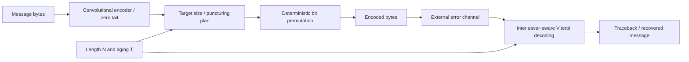

# Adaptive ECC for Flash-Inspired Errors

A C++17 error-correcting codec combining terminated convolutional coding,
adaptive puncturing, deterministic interleaving, and hard-decision Viterbi
decoding. It balances recovery, encoded size, and runtime under a coursework
Flash-inspired error model.

以 convolutional code、交錯排列與 Viterbi 解碼保護資料，依 aging 參數調整冗餘。
保留提交版本，附上設計說明、歷史實驗結果與可重跑的獨立驗證。

Developed for National Tsing Hua University, IIS5008 Hardware Security,
Final Project (2026). [Assignment](docs/spec/assignment.pdf) ·
[Course slides](docs/spec/project_slides.pdf) · [Original report](docs/report/report.pdf).

## Design features

- **Size-dependent protection:** constraint length 11 for messages up to 256
  bytes, and 12 above that threshold, giving 1,024 or 2,048 trellis states.
- **Aging-adaptive redundancy:** target encoded size is approximately 1.5×,
  1.75× or 2× the original, rounded to bytes and bounded by `2N`.
- **Integrated interleaving:** retained parity bits are placed directly using
  bit reversal for eligible lengths or a coprime affine permutation otherwise.
- **Efficient decoder state:** rolling path metrics, precomputed trellis outputs,
  a small Hamming-distance table and one predecessor-choice byte per state/step.
- **Standard-library implementation:** the encoder and decoder require no
  external libraries and use the required file-based `solution` interface.

## Architecture



The program implements the codec; the official channel/evaluator is external.
See [architecture](docs/ARCHITECTURE.md) for generator masks, rate thresholds,
puncturing, permutation rules and memory cost.

## Performance and verification

The original report records **100% correctness on public1–public4**, with average
encoded/original ratios **1.5000 / 1.6250 / 1.9500 / 1.9625**. The official
evaluator and public fixtures were not supplied, so those historical results
have not been independently reproduced here.

Fresh deterministic synthetic tests on **2026-11-11 (Asia/Taipei)** produced:

| Test channel | Exact recoveries |
| --- | ---: |
| No corruption | **228 / 228** |
| One flipped bit | 25 / 25 |
| 1% distinct random bit flips | 25 / 25 |
| Two-byte fully flipped burst | 20 / 25 |
| Eight flips within a 32-bit window | 23 / 25 |
| Illustrative aging-intensity IID flips | 24 / 25 |

All **353** tested encoded lengths met the `2N` cap; **228** repeated encodes
were identical. Corrupted-channel recovery was **117/125**; all eight failed
recoveries are retained. These synthetic channels are explicitly separate from
the official Flash model and do not establish hidden-case correctness.

[Summary](docs/evidence/release/summary.json) ·
[Per-trial results](docs/evidence/release/trials.csv) ·
[Full stimuli/results](docs/evidence/release/trials.jsonl) ·
[Performance and limits](docs/PERFORMANCE.md).

## Build and run

Requires g++ with C++17 support and Make. Python 3.9+ runs the added verification
helpers. The original Makefile is unchanged; `make -B` forces a fresh build.

```bash
make -B
mkdir -p .build/demo
bin/solution encode 1000 examples/message.txt .build/demo/encoded.hex
printf '8\n' > .build/demo/received.txt
cat .build/demo/encoded.hex >> .build/demo/received.txt
bin/solution decode 1000 .build/demo/received.txt .build/demo/decoded.hex
python3 scripts/check_project.py
python3 scripts/run_tests.py
```

Encode input is `N` followed by the message hex line. Decode input is `N`
followed by the received codeword hex line. Each mode writes one uppercase hex
line. The example above is a noiseless eight-byte round trip.

The test helper builds a clean isolated copy, applies a one-second limit to
each codec call, and saves evidence under `.build/`. The supplied prebuilt
executable is omitted from Git; source files and original Makefile are unchanged.

## Repository layout

```text
src/ and include/         Preserved codec and file-interface implementation
Makefile                 Original build: bin/solution
examples/                Minimal CLI input
scripts/                 Portfolio tests and source-preservation checks
tests/                   Verification scope
docs/spec/               Assignment and project slides
docs/report/             Original report
docs/notes/              Supplied Makefile tutorial
docs/evidence/release/    Fresh synthetic test results and hashes
```

[Provenance](docs/PROVENANCE.md) identifies original and added artifacts.
